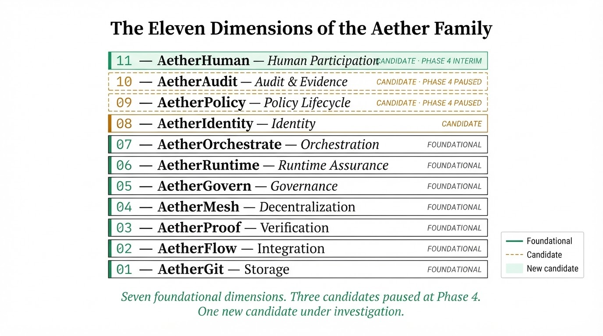
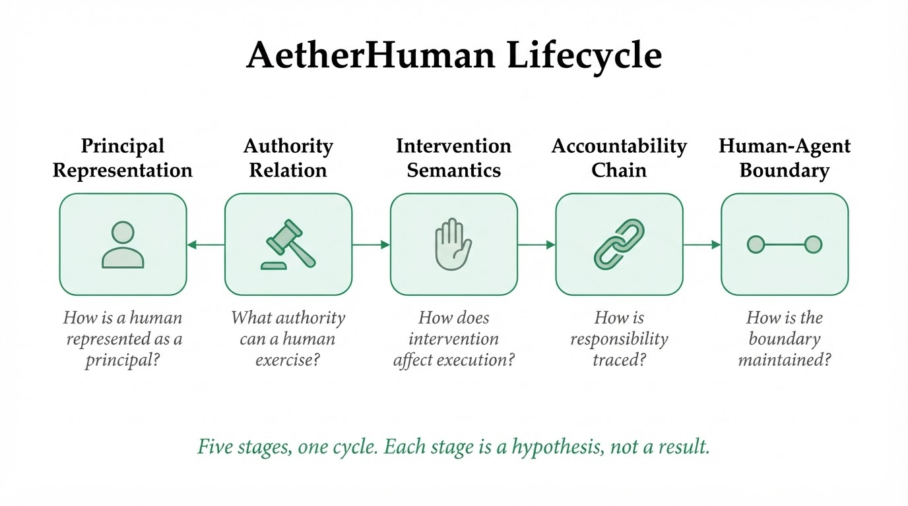
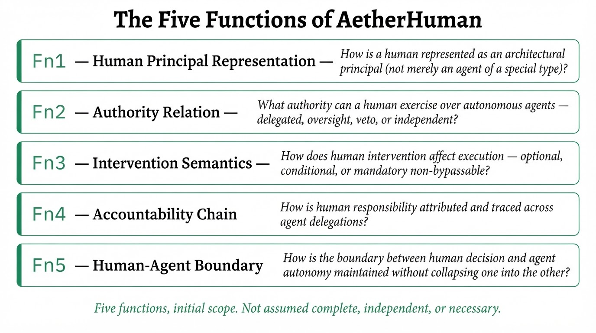
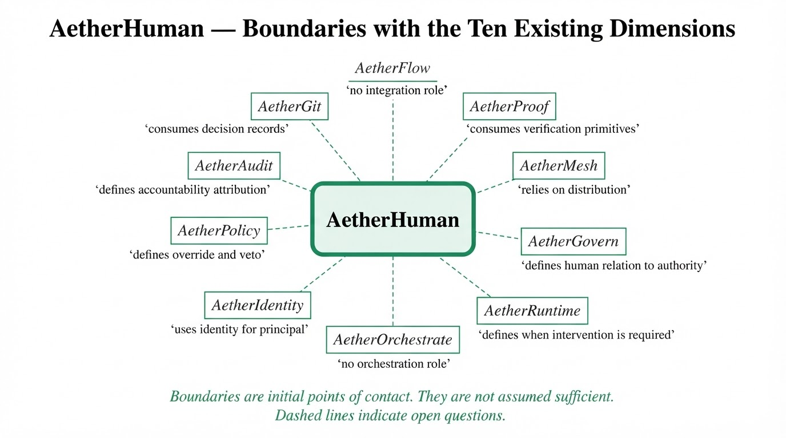
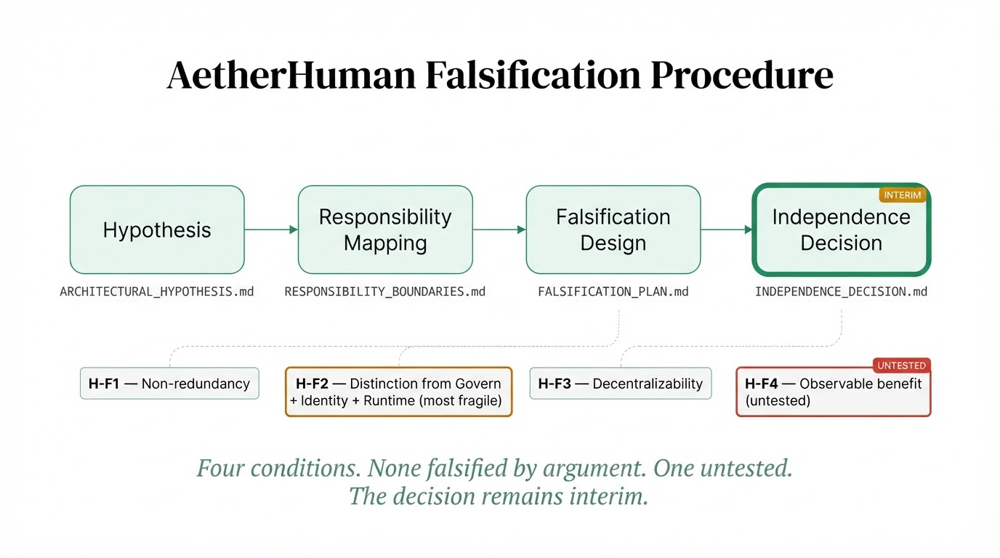
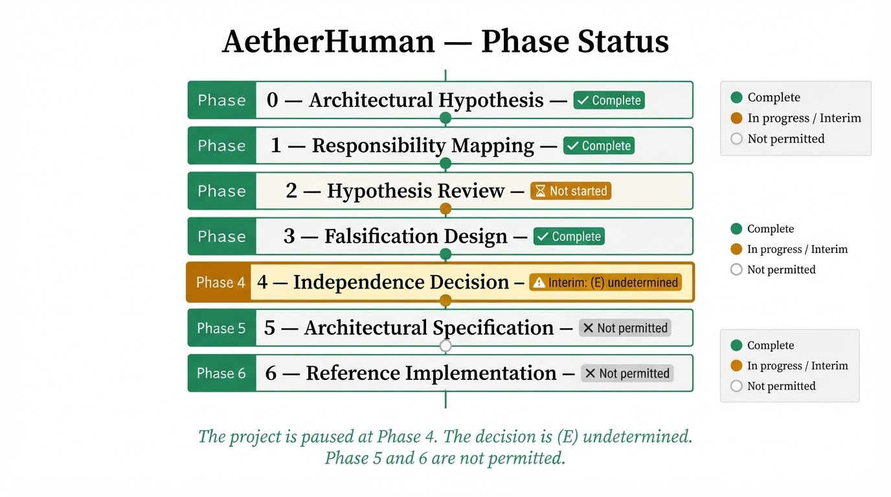
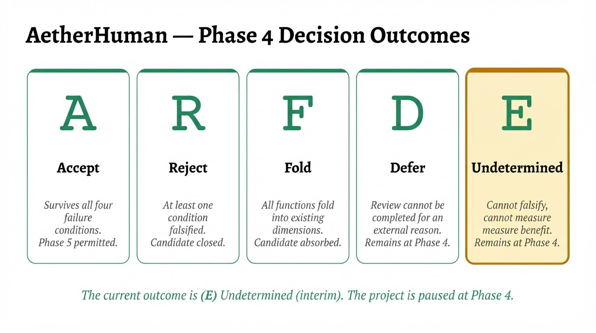
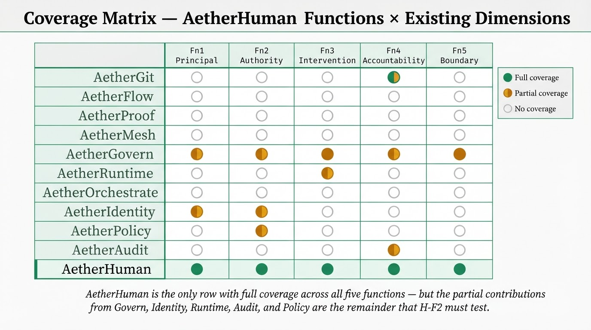
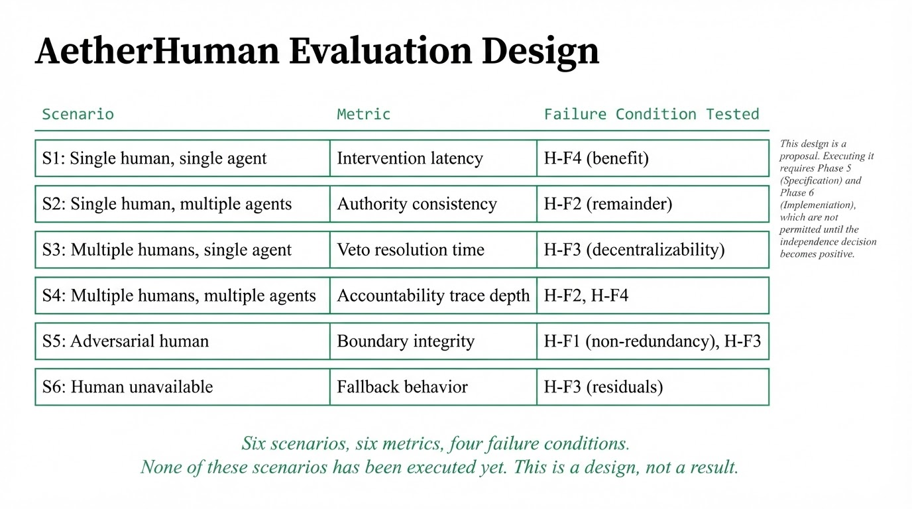

# AetherHuman — Architectural Hypothesis

**Status:** Hypothesis under investigation. Not a committed project.
**Position in the Aether family:** Eleventh project (candidate).
**Date:** 2026-11-17
**Version:** 1.0.0
**Author:** Samir Baladi
**ORCID:** [0009-0003-8903-0029](https://orcid.org/0009-0003-8903-0029)
**License:** CC-BY-4.0 (this document)

---

## 0. Status of this document

This document states a hypothesis. It does **not** state a result.

- It does **not** claim that AetherHuman is an independent architectural dimension.
- It does **not** claim that the gap it describes is genuine.
- It does **not** claim that the boundaries with AetherGovern, AetherIdentity, AetherRuntime, and the other dimensions are sufficient.
- It does **not** authorize implementation.

The next steps are: review of this hypothesis, review of the responsibility boundaries, definition of falsification conditions, and a decision on architectural independence. Only after that decision may specification or implementation begin.

---

## 1. Position in the Aether family

The Aether family currently has **seven foundational dimensions** and **four candidates** (including AetherHuman):

| # | Project | Status |
|---|---|---|
| 1 | AetherGit | Foundational |
| 2 | AetherFlow | Foundational |
| 3 | AetherProof | Foundational |
| 4 | AetherMesh | Foundational |
| 5 | AetherGovern | Foundational |
| 6 | AetherRuntime | Foundational |
| 7 | AetherOrchestrate | Foundational |
| 8 | AetherIdentity | Candidate (paper + v2.0.0; independence not settled) |
| 9 | AetherPolicy | Candidate (Phase 4: undetermined) |
| 10 | AetherAudit | Candidate (Phase 4: undetermined) |
| 11 | **AetherHuman** | **Candidate (this document; not yet studied)** |

AetherHuman is the **eleventh project**. It is **not** a replacement for AetherGovern, AetherIdentity, or AetherAudit, and it does **not** renumber any of them. All remain candidates with unresolved independence.

---

## 2. Central question

> **How can human participation — as principal, overseer, or mandatory intervention point — be represented in a decentralized autonomous agent ecosystem, without reducing it to delegated authority or breaking the autonomy assumptions of the existing dimensions?**

This is the initial central question. It is subject to revision after the hypothesis review.

The question carries four clauses:

| Clause | Condition |
|---|---|
| (i) Not already covered by Govern, Identity, or Runtime | H-F1 |
| (ii) Does not decompose into Govern + Identity + Runtime | H-F2 |
| (iii) No central human authority required | H-F3 |
| (iv) Observable benefit | H-F4 |

---

## 3. Five functions (initial scope)

The following five functions are proposed as the **initial scope**. They are not final requirements. Each is subject to falsification.

| # | Function | Question |
|---|---|---|
| Fn1 | **Human Principal Representation** | How is a human represented as an architectural principal (not merely an agent of a special type)? |
| Fn2 | **Authority Relation** | What authority can a human exercise over autonomous agents — delegated, oversight, veto, or independent? |
| Fn3 | **Intervention Semantics** | How does human intervention affect execution — optional, conditional, or mandatory non-bypassable? |
| Fn4 | **Accountability Chain** | How is human responsibility attributed and traced across agent delegations? |
| Fn5 | **Human-Agent Boundary** | How is the boundary between human decision and agent autonomy maintained without collapsing one into the other? |

These five are **not** assumed to be complete, independent, or necessary. A later phase may drop one, merge two, or add a sixth.

---

## 4. Architectural hypothesis

> **A potentially independent architectural gap may exist between governance authority, identity, and runtime monitoring: the operational representation of human participation — its principal status, authority relations, intervention semantics, accountability, and boundary with agent autonomy — across decentralized autonomous agents.**

This is a hypothesis. It is stated so that it can fail. Specifically:

- If **AetherGovern** already provides all human-participation requirements without an additional layer, the gap is not independent.
- If **AetherGovern plus AetherIdentity plus AetherRuntime** cover the five functions with bounded integration, the gap is not independent.
- If **no independent properties** of human authority, intervention, or accountability exist, the gap is not independent.
- If the candidate is only an **aggregation of existing authority and identity mechanisms under a unified interface**, the gap is not independent.
- If a **central human authority** is required, decentralizability (H-F3) fails.
- If no **observable benefit** is demonstrated, H-F4 fails.

The hypothesis is falsified if any of the above holds.

---

## 5. Boundaries with the Aether family

The following boundaries are the **initial points of contact**. They are not assumed to be sufficient.

### 5.1 With the seven foundational dimensions

| Dimension | Responsibility | AetherHuman's relation |
|---|---|---|
| **AetherGit** | Storage and versioning | AetherHuman may consume audit/evidence records; it does not store source |
| **AetherFlow** | Integration | AetherHuman does not integrate |
| **AetherProof** | Verification | AetherHuman may require verification of human decisions; it does not replace AetherProof |
| **AetherMesh** | Decentralization | AetherHuman relies on AetherMesh for distribution of human decisions; it does not distribute itself |
| **AetherGovern** | Governance authority | AetherHuman defines the human's relation to authority; it does not replace governance |
| **AetherRuntime** | Runtime assurance | AetherHuman defines when human intervention is required; it does not monitor |
| **AetherOrchestrate** | Orchestration | AetherHuman does not orchestrate |

### 5.2 With the three candidates

| Dimension | Responsibility | AetherHuman's relation |
|---|---|---|
| **AetherIdentity** | Determination of agent identity | AetherHuman uses identity to represent the human principal; it does not determine identity |
| **AetherPolicy** | Policy evaluation and enforcement | AetherHuman defines who may override or veto policy; it does not evaluate policy |
| **AetherAudit** | Evidence and accountability | AetherHuman defines human accountability attribution; it does not replace audit |

### 5.3 Boundaries are not assumed sufficient

The boundaries are **not assumed to be sufficient**. A later phase must analyze whether:

- AetherGovern's authority model already covers the human principal.
- AetherIdentity's identity model already covers the human's identity.
- AetherRuntime's monitoring already covers mandatory human intervention.
- AetherPolicy's enforcement already covers veto and override.
- AetherAudit's attribution already covers human accountability.
- The boundaries overlap in ways that make AetherHuman a feature, not a dimension.

---

## 6. Falsification-first methodology

AetherHuman follows the same falsification-first methodology as AetherAudit:

1. **Architectural Hypothesis** (this document).
2. **Responsibility Mapping** — boundaries with the existing dimensions.
3. **Hypothesis Review** — independent review of the hypothesis and the boundaries.
4. **Falsification Design** — specific conditions under which AetherHuman does not deserve to be a separate dimension.
5. **Independence Decision** — a decision on whether the candidate is independent.
6. **Specification** — only if the independence decision is positive.
7. **Implementation** — only after specification.
8. **Evaluation** — only after implementation.

**No implementation begins before step 5.**

The falsification conditions will be designed **for AetherHuman**, not copied from AetherAudit's A-F1–A-F4. They will address:

- Whether the five functions are already covered by AetherGovern, AetherIdentity, AetherRuntime, or a bounded extension of one of them.
- Whether human authority and accountability can be reduced to existing identity or governance mechanisms.
- Whether human intervention requires a central authority or a trust anchor.
- Whether AetherHuman yields an observable benefit over existing mechanisms.

These are **directions**, not final conditions. The final conditions are set in step 4.

---

## 7. What this document does not claim

- That AetherHuman is an independent architectural dimension.
- That the five functions are complete.
- That the boundaries with AetherGovern, AetherIdentity, AetherRuntime, and the other dimensions are sufficient.
- That the gap is genuine.
- That implementation should begin.

This document claims only that the hypothesis is worth investigating under the stated methodology.

---

## 8. Next steps

In order:

1. **Responsibility mapping** of the five functions against the existing dimensions.
2. **Independent review** of this hypothesis and the boundaries.
3. **Falsification conditions** designed for AetherHuman (H-F1 to H-F4).
4. **Independence decision**: is AetherHuman a separate dimension, a feature of AetherGovern, a feature of AetherIdentity, a feature of AetherRuntime, or a bounded extension of one of them?
5. **If independent**: specification (`SPECIFICATION.md`).
6. **If not independent**: report the result, and do not proceed to implementation.

Stopping after step 4 is a legitimate outcome.

---

## Appendix A — Relationship to existing Aether projects

| Project | Relation to AetherHuman |
|---|---|
| AetherGit | Storage of human decision records (not human authority) |
| AetherFlow | Integration events may require human approval (not human authority itself) |
| AetherProof | Verification of human-authorized actions (not human intervention) |
| AetherMesh | Distribution of human decisions (not human authority) |
| AetherGovern | Source of authority delegation (not human principal status) |
| AetherRuntime | Runtime detection of human intervention needs (not intervention semantics) |
| AetherOrchestrate | Orchestration of tasks that may require human input (not human authority) |
| AetherIdentity | Identity of the human principal (not human authority) |
| AetherPolicy | Policy that human may override or veto (not human authority itself) |
| AetherAudit | Accountability records (not human accountability attribution) |

This appendix is a hypothesis about relations. It is not a result.

---

## Appendix B — Open questions (initial)

- Q1. Is human principal representation a deterministic function of identity, or does it depend on context not available to AetherIdentity?
- Q2. Can human authority be fully represented as delegated agent authority — or does veto require an independent anchor?
- Q3. Can mandatory human intervention be modeled as a runtime constraint without breaking agent autonomy?
- Q4. Can human accountability be attributed without a trust anchor that audit evidence itself cannot supply?
- Q5. Does human participation require a central authority, or can it be decentralized?
- Q6. What is the minimal interface between AetherHuman and AetherGovern?
- Q7. What is the minimal interface between AetherHuman and AetherIdentity?
- Q8. What is the minimal interface between AetherHuman and AetherRuntime?
- Q9. Can AetherHuman's observable benefit be distinguished from AetherGovern's?
- Q10. Can the five functions be reduced to fewer than five?

These are initial questions. They are not final.

---

## Appendix C — Figures

| # | Figure | Description |
|---|---|---|
| 1 |  | The eleven dimensions of the Aether family, with AetherHuman as candidate #11 |
| 2 |  | The AetherHuman lifecycle |
| 3 |  | The five functions of AetherHuman (Fn1–Fn5) |
| 4 |  | AetherHuman and its boundaries |
| 5 |  | The falsification procedure (H-F1 to H-F4) |
| 6 |  | Phase status (paused at Phase 4) |
| 7 |  | The five Phase 4 outcomes (A / R / E / F / D) |
| 8 |  | Coverage matrix: five functions × existing dimensions |
| 9 |  | Evaluation design |

---

**AetherHuman v1.0.0 — Architectural Hypothesis**
© 2026 Samir Baladi — Ronin Institute / Rite of Renaissance
DOI: [10.5281/zenodo.24278322](https://doi.org/10.5281/zenodo.24278322)
